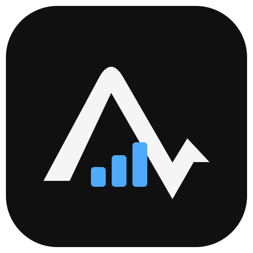
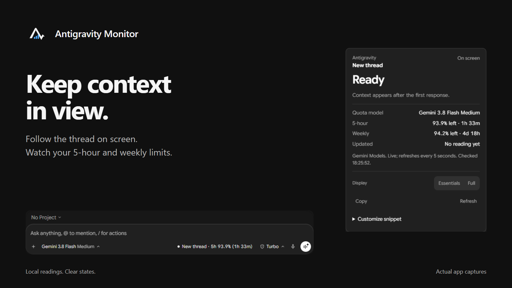
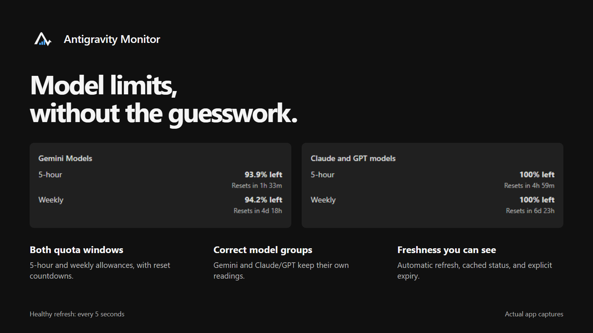
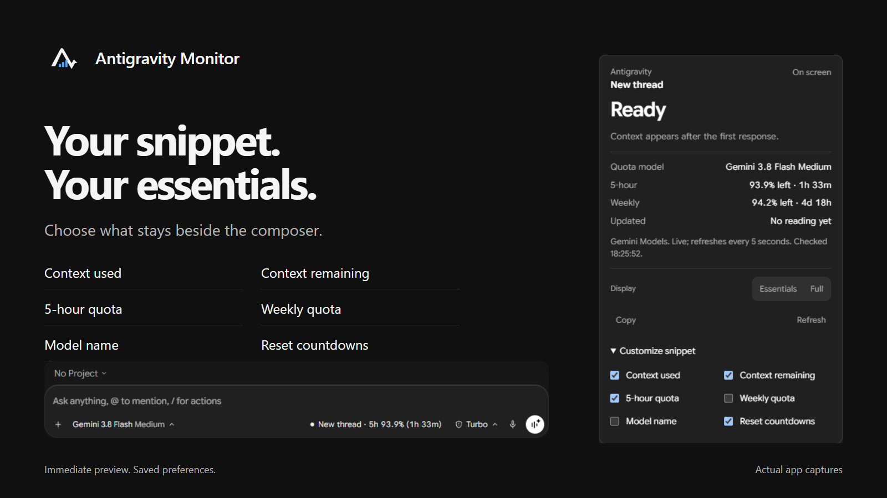

<p align="center">
  <a href="https://github.com/benedictusrey/Antigravity-Monitor">
    
  </a>
</p>

<h1 align="center">Antigravity Monitor</h1>

<p align="center">
  <strong>Know your context. Keep an eye on your model limits.</strong><br>
  Local monitoring for Antigravity desktop, Antigravity IDE, and Visual Studio Code.<br>
  Built with <code>TypeScript</code> and <code>Node.js</code>.
</p>

<p align="center">
  <a href="https://github.com/benedictusrey/Antigravity-Monitor/releases"></a>
  <a href="https://nodejs.org/"></a>
  <a href="LICENSE"></a>
</p>

<p align="center">
  <a href="https://github.com/benedictusrey/Antigravity-Monitor/releases/tag/v1.0.0">Download v1.0.0</a> ·
  <a href="USER_GUIDE.md">User guide</a> ·
  <a href="PRIVACY.md">Privacy</a> ·
  <a href="https://github.com/benedictusrey/Antigravity-Monitor/actions/workflows/ci.yml">Build checks</a> ·
  <a href="https://github.com/benedictusrey/Antigravity-Monitor/issues">Report an issue</a>
</p>



Antigravity Monitor adds a small composer readout, a detail card, and a dashboard to Antigravity. It follows the visible conversation, distinguishes a new thread, and refreshes 5-hour and weekly quotas automatically. Native extensions add a status bar and dashboard inside Antigravity IDE and Visual Studio Code.

## Get started

Download **Antigravity-Monitor-1.0.0-companion.zip**, extract the entire folder, and keep its files together. Install [Node.js 22 or newer](https://nodejs.org/) first. No administrator or sudo access is needed.

| Platform | Install from the extracted folder | Startup |
|---|---|---|
| **Windows** | Open **Install Antigravity Monitor.exe**. The readable `.cmd` remains available. | Current user's Startup shortcut. |
| **macOS** | In Terminal, run `sh "Install Antigravity Monitor.command"`. | User LaunchAgent loaded with `launchctl`. |
| **Linux** | In a graphical desktop session, run `sh "Install Antigravity Monitor.sh"`. | XDG desktop autostart entry. |

Open Antigravity normally. The companion stays separate from the app and reconnects when its local backend and DevTools endpoint become available. The dashboard is at **http://127.0.0.1:4599**. Installers also install the included VSIX into supported editor CLIs they find; reload editor windows afterward.

**Windows has been tested locally. macOS and Linux implementations include discovery, storage, installers, and startup integration; native platform acceptance remains pending.** Linux needs `ps` and either `lsof` or `ss` for socket discovery, plus `xdg-open` to launch the dashboard. macOS uses `ps`, `lsof`, `open`, and `launchctl`.

The white Antigravity desktop app has no VS Code extension host. It needs the companion, not only the VSIX. If its badge is missing, see [DevTools setup](USER_GUIDE.md#enable-the-inline-badge). The monitor does not patch Antigravity's installed files.

> [!IMPORTANT]
> On Windows, do not double-click the VSIX. Microsoft's Visual Studio installer cannot install VS Code extensions. Use the project installer or an editor's **Install from VSIX** command.

The Windows EXE launchers embed the project logo and call the commands beside them. Keep the extracted package together. Installed Start Menu and Startup shortcuts use a multi-size ICO. Linux autostart carries the PNG icon; an ICNS asset is included for macOS packaging.

## What you can see



| Feature | What it tells you |
|---|---|
| **Context window** | Used, remaining, and capacity tokens. Readings identify provider measurements and local estimates. |
| **Conversation awareness** | The visible thread, a new thread, or an unidentified selection. Delayed data from another thread is rejected. |
| **Live quotas** | Separate 5-hour and weekly limits for Gemini and Claude/GPT groups, with reset countdowns and freshness. |
| **Multiple apps** | Each discovered app keeps its own conversation. Choose an app in the dashboard to follow it. |
| **Sessions and models** | Conversation summaries, model capacities, and available quota information. |
| **Usage history** | Locally observed token totals and an API-equivalent cost estimate where pricing is available. |
| **Compact controls** | Open details, refresh readings, copy a summary, or choose what stays in the snippet. |

Healthy quota requests run every five seconds, independently of transcript reads. A slow conversation read does not hold up other apps' summary polling. Failures back off; cached quotas expire after 30 seconds or at their reported reset. Missing information stays unavailable rather than becoming an invented zero or full allowance.

## Choose your snippet



Click the composer readout, then expand **Customize snippet**. Choose context used, context remaining, 5-hour quota, weekly quota, model name, and reset countdowns. Changes preview immediately and save automatically. **Essentials** and **Full** remain quick presets.

The companion's preferences apply to its inline snippets across connected apps. Each native editor extension keeps its own status-bar preferences. Long snippets truncate within the composer; detailed readings remain available in the tooltip and card.

Banner UI captures come from the running application. Quotas and times are observations from capture time, not promises of a particular allowance. Banner artwork contains no release version so it can be reused.

## Privacy and security

Monitoring requests stay on loopback. The app does not proxy model traffic or send analytics. Backend request tokens remain in memory and are not included in dashboard snapshots. Account details are masked by default.

The monitor reads conversation state to calculate context usage. It stores aggregate usage and preferences locally; diagnostics can contain conversation titles and connection metadata. Review logs and screenshots before sharing them. DevTools access can control local app pages, so keep debugging endpoints local and use only trusted software. Read [PRIVACY.md](PRIVACY.md) and [SECURITY.md](SECURITY.md).

## Build and verify

```sh
npm ci
npm run compile
npm test
npm run package
```

The companion has no third-party runtime dependencies. Development tools are pinned in the lockfile. Run `npm run live` against a running Antigravity backend for local integration checks; its diagnostic output may include conversation titles.

See [Architecture](docs/ARCHITECTURE.md), [Audit and validation](docs/AUDIT.md), and [Release preparation](RELEASING.md) for implementation details and verification limits. The source, extension package, companion, and current release files use **v1.0.0**.

On Windows, run `powershell.exe -NoProfile -ExecutionPolicy Bypass -File scripts/build-windows-launchers.ps1` before installing from source or building a complete companion release. Building needs the Windows .NET Framework C# compiler. Downloaded packages already contain the launchers and need no compiler. Run `scripts/check-windows-launchers.ps1` to verify embedded icons and launch targets.

## Known limits

- Quotas use polling, not server push. Backend latency, unsupported RPCs, and retry backoff can delay updates.
- Inline badges need a reachable DevTools endpoint. Native editor status bars do not.
- Native status bars use the measured conversation model. The white-app badge can also observe the model selected for the next response.
- Usage starts when monitoring begins. Cost figures are estimates, not subscription billing.
- Multiple windows sharing one backend can remain ambiguous. The monitor avoids choosing an unrelated conversation when selection is explicit.
- The current release is unsigned. Native macOS/Linux startup, screen readers, and high-contrast themes need further acceptance testing.

## Contribute

Reproducible bug reports, platform tests, clearer documentation, and focused fixes are welcome. Read [CONTRIBUTING.md](CONTRIBUTING.md) and [SUPPORT.md](SUPPORT.md) before sharing diagnostics.

## License

Developed by [Benedictus RH (@benedictusrey)](https://github.com/benedictusrey). Released under the [MIT License](LICENSE), without warranty.

Antigravity Monitor is an independent community project. It is not affiliated with Google, Microsoft, or their products.
